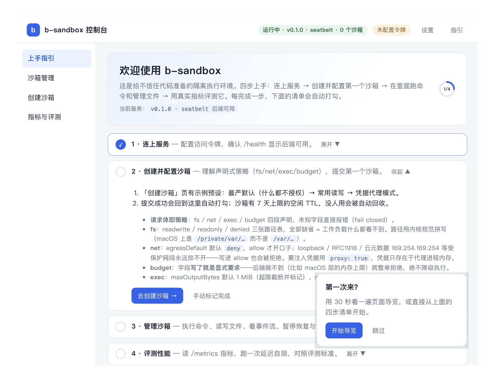

# b-sandbox

面向 AI Agent 工作负载的沙箱服务：把不可信的 shell 命令、生成代码、文件操作放进隔离环境，通过 HTTP API 使用。每个工作负载都有独立的隔离环境、声明的资源预算和显式的网络/文件系统策略——任何 Agent 提交的东西都不会裸跑在宿主机上。

为 [b-superagent](../b-superagent) 服务的组件；隔离模型与 API 形态对齐 E2B 事实标准（对标分析见 [docs/production-readiness.md](docs/production-readiness.md)）。



## 核心能力

- **策略即数据**：fs / net / exec / budget 是声明式策略，附在工作负载上；执行落在每个后端的一处，绝不散落调用点。未知字段、缺失策略、歧义路径一律拒绝（fail closed）。
- **后端是接缝**：生命周期、策略、API、可观测全部与后端无关。进程级（macOS Seatbelt / Linux Bubblewrap）今天可用；microVM（libkrun）按 [docs/m3-microvm.md](docs/m3-microvm.md) 设计就绪，等 Linux + `/dev/kvm` 宿主。
- **能力位必须带执行证据**：后端声明的每个能力位，都有翻转策略输入并观测到工作负载行为变化的测试——路径逃逸、symlink 逃逸、悬空 symlink 写穿透、profile 注入、输出洪泛、fork bomb（差分证据）、终止后进程组回收、egress 私网拒绝。
- **可观测**：Prometheus `/metrics`（计数/直方图/gauge，路由模式归一化保证基数闭包，401/404/413/panic 全部计入）、结构化日志（tracing）、每沙箱 usage 账本、事件日志 + SSE 实时流（Last-Event-ID 重连）。
- **生产运维**：优雅停机（SIGTERM → 关停全部沙箱 → SSE 收口 → drain）、启动孤儿回收、单实例 flock 锁（容器内 pid 恒为 1 的 crash loop 从模型上根除）、panic 防护层、8 MiB 请求体上限、Bearer 认证（常量时间比较）、幂等创建、空闲 TTL 回收、凭据注入 egress 代理（私网/环回/云元数据默认拒绝，令牌永不进入沙箱）。
- **性能有预算**：`tests/perf.rs` 标定门槛（API 单周期 <2 ms、并行 >300 cycles/s、exec mean <50 ms）+ `tests/bench.rs` 基准 + `scripts/bench.sh` 真实二进制测量（空闲 RSS ≈ 3.1 MB）。

## 快速开始

**1. 启动服务**（macOS：Seatbelt 后端；Linux 换 `--backend bwrap`）

```bash
cargo run -p sandbox-api -- --data-root /tmp/b-sandbox --port 8094
curl -s localhost:8094/health
```

**2. 走一遍生命周期**

```bash
curl -s -X POST localhost:8094/sandboxes -H 'content-type: application/json' -d '{}'
curl -s -X POST localhost:8094/sandboxes/<id>/exec \
  -H 'content-type: application/json' -d '{"command":"/bin/echo","args":["hi"]}'
curl -s -X DELETE localhost:8094/sandboxes/<id>
```

**3. 打开 Web 控制台（自带四步新手指引）**

```bash
cd web && pnpm install && pnpm build   # 产出 web/dist
cd .. && cargo run -p sandbox-api -- --data-root /tmp/b-sandbox
# 打开 http://127.0.0.1:8094/ → 自动跳转 /console
```

控制台默认首页是**上手指引**（参考 Microsoft Copilot Studio 的 first-run 清单模式）：四步任务卡——连上服务 → 创建并配置沙箱 → 管理沙箱 → 评测性能，每步自动检测完成证据（health 探测 / 创建成功 / 执行成功 / 自测完成），可手动标记；首次访问有页面导览，可跳过、可随时重放。其余页面：创建沙箱（策略表单 + 三个示例预设）、沙箱管理（执行/文件/事件流/生命周期/模板）、指标与评测（**评测标准表** + 50 次真实 echo 的延迟自测，对照 ≤50 ms 门槛判定）。

**4. 质量门**（fmt + clippy -D warnings + 全部测试）

```bash
./scripts/gate.sh          # Rust：23 个测试套件 / 222 个测试
cd web && pnpm gate        # 前端：lint + typecheck + format + 21 个测试
```

## API 一览

完整契约见 [docs/openapi.yaml](docs/openapi.yaml)（OpenAPI 3.0.3，`tests/contract.rs` 三向锁定路由 ↔ 契约 ↔ 错误码）；类型化 Rust 客户端在 `crates/sandbox-sdk/`。

| 路由 | 用途 |
| --- | --- |
| `GET /health` | 后端可用性 + 版本 + 活跃沙箱数（唯一免认证路由） |
| `POST /sandboxes` · `GET /sandboxes` | 创建（请求体即策略，Idempotency-Key 幂等）· 列表 |
| `GET/DELETE /sandboxes/{id}` | 详情（状态 + TTL + usage 账本）· 终止（含进程组回收） |
| `POST /sandboxes/{id}/pause·resume·commit` | 暂停 / 恢复 / 提交为命名模板（clonefile 秒级物化） |
| `POST /sandboxes/{id}/exec` | 同步执行命令：exitCode / timedOut / truncated / stdout / stderr |
| `POST /sandboxes/{id}/files/…` | read / write / list / stat / mkdir / remove（遍历与 symlink 逃逸在策略层拒绝） |
| `GET /sandboxes/{id}/events[/stream]` | 事件分页重放 / SSE 实时流 |
| `GET /metrics` | Prometheus 文本格式 0.0.4 |

## 文档

- [docs/design.md](docs/design.md) — 架构设计（中文）
- [docs/production-readiness.md](docs/production-readiness.md) — 生产级标准 24 条与 4 个开源沙箱项目的对标分析（中文）
- [docs/production-report.md](docs/production-report.md) — 验证报告：实测数据、评审修复记录、复现清单（中文）
- [docs/m3-microvm.md](docs/m3-microvm.md) — microVM 后端设计（英文）
- [vendor/README.md](vendor/README.md) — 参考项目溯源（只读，不编译）

## 部署

`scripts/deploy.sh`：交叉编译（musl/zig）→ scp → 服务器 docker build → compose up → 健康检查。容器只绑 `127.0.0.1`（nginx 是唯一门面）、只读 rootfs、`cap_drop: ALL`；令牌走 `B_SANDBOX_AUTH_TOKEN`，egress 凭据在 0600 文件 + 代理进程内存——密钥不进镜像与仓库。

## License

Apache-2.0（见 [LICENSE](LICENSE)）
