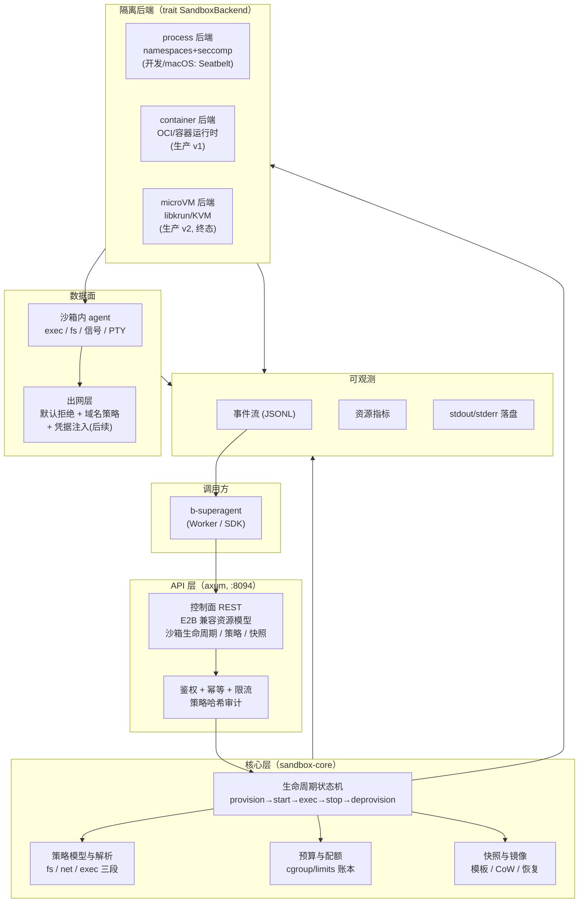
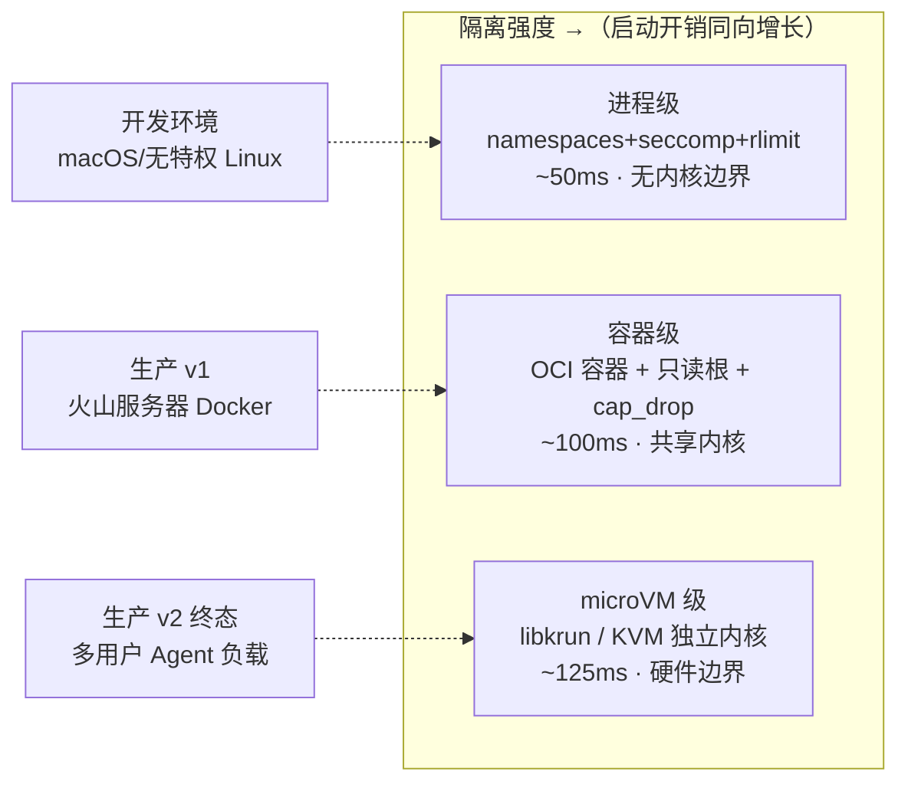
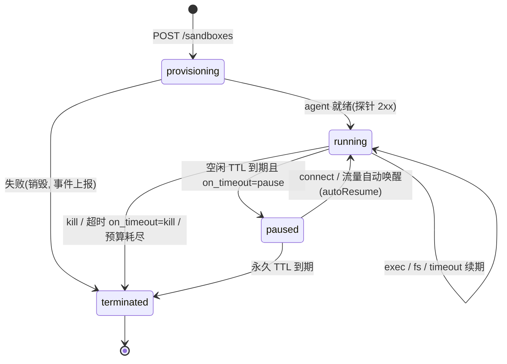
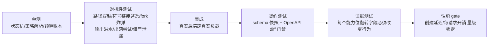

# b-sandbox 整体技术设计方案

> 状态：v0.1 草案（2026-11-15）。本文是高屋建瓴的整体设计，不含字段级 API 定义；后者在实现前以 RFC 形式另立。
> 依据：对 `vendor/` 下五个参考项目的深读（CubeSandbox、MXC、E2B、microsandbox、awesome-sandbox），结论均在文中标注出处。

---

## 1. 定位与边界

**b-sandbox 是给 b-superagent 用的沙箱服务**：把 Agent 产生的不可信负载——shell 命令、生成代码、文件读写——放进隔离环境执行，通过 HTTP API 暴露"创建环境 → 执行 → 观察 → 回收"的完整生命周期。b-superagent 的 Worker 目前直接把 claude CLI 跑在房间文件夹里（`../b-superagent/README.md` 的架构图），b-sandbox 的使命是让这一层变成"声明了预算与策略的隔离执行"。

三句话定义产品：

1. **一个 workload = 一个隔离环境 = 一份预算。** 环境（沙箱）是唯一执行单元，CPU/内存/时长/网络在创建时声明，全程可观测。
2. **策略是数据，强制是后端。** 文件系统/网络/执行权限以声明式策略附着在沙箱上，由隔离后端统一执行；策略不能强制时**拒绝执行，绝不静默降级**（MXC 的核心教训，见 `vendor/mxc/docs/backends/bwrap/bubblewrap-backend.md` "Declaration alone is not evidence"）。
3. **API 对齐 E2B 事实标准。** E2B 的 REST 资源模型是业界默认（98 path/125 op，`vendor/e2b/spec/openapi.yml`），CubeSandbox 甚至以"Python SDK 195 用例全通过"为卖点（`vendor/cubesandbox/docs/.vitepress/theme/E2BCompatibilityPage.vue`）。兼容它能直接复用现成 SDK 生态，降低 b-superagent 的集成成本。

**不做什么**（边界）：不做 Agent 编排（那是 b-superagent 的 Router/Worker 的事）、不做多租户计费与团队管理（E2B Cloud 的范畴）、v1 不做跨节点集群调度（CubeSandbox 的 CubeMaster/Cubelet 分层是终态而非起点）。

---

## 2. 业界格局：五份参考告诉我们什么

| 项目 | 隔离底座 | 产品形态 | 对本项目的核心价值 |
| --- | --- | --- | --- |
| **E2B** | Firecracker microVM（编排器在 `e2b-dev/runtime` 仓库） | SaaS + 自托管，spec/SDK 切片 | API 资源模型的事实标准；envd 双层协议（HTTP + ConnectRPC）；暂停一致性钩子链（`/freeze→/collapse→/fsfreeze→快照→/unfreeze`） |
| **CubeSandbox**（腾讯云） | KVM MicroVM（Cloud Hypervisor fork）+ containerd shim | 全栈自托管服务 | **护城河三件套**：模板快照恢复启动（41ms@并发1）、FICLONE/reflink CoW 磁盘、预格式化资源池；eBPF 网络数据面；透明 L7 出网代理 |
| **MXC**（微软） | 11 种后端统一抽象（ProcessContainer/Bubblewrap/Seatbelt/LXC/MicroVM…） | 可嵌入 SDK 库 + CLI 执行器 | 版本化封闭契约 + 能力位声明 + "拒绝而非降级"；策略哈希审计；拒绝捕获诊断 |
| **microsandbox** | libkrun microVM，**无 daemon** | 单机二进制 + 5 语言 SDK | Rust-native 的进程/协议/快照内核；配置走继承 fd 防 `ps` 泄漏；exec 双向额度背压；兼容性台账 |
| **awesome-sandbox** | — | 方案清单 | 隔离谱系对照（VM/应用内核/语言运行时/容器）；凭证注入代理作为独立组件的共识（iron-proxy/Agent Vault/Docker Sandboxes/Deno 四家同构） |

三条硬结论（分别来自三个项目的复盘，详见 `vendor/cubesandbox` 与 `vendor/mxc` 深读报告）：

1. **快启动靠"快照恢复 + 共享 + 预热"，不靠热池。** CubeSandbox 官方博客明确热池已整体退役（`docs/zh/blog/posts/2026-09-03-guangdong-rising.md:25`）， replaced by "模板 APP 快照 + lazy EPT + reflink rootfs + 预格式化盘"，创建 41ms（`2026-10-28-cubebench-073.md`）。
2. **E2B 兼容的成本在数据面协议，不在 REST。** CubeSandbox 的做法是控制面翻译 + 沙箱内直接复用 envd 二进制（从 `e2b-dev/infra` 编译，`:49983`），把兼容成本降到"路由 + 认证"。自研 envd 替代品意味着长期维护 195 个兼容用例。
3. **网络是最被低估的部分。** CubeSandbox 为网络写了 5.5k 行 eBPF + 18k 行 Go 控制面 + 2.6k 行 L7 出网代理 Lua；设计必须把"出网策略/域名过滤/凭据注入/审计"当一等公民，而不是"加个 iptables"。

---

## 3. 设计原则

以下七条是全项目的宪法，任何模块设计不得违反：

1. **Fail closed.** 策略缺失、后端不可用、强制失败、路径歧义 → 拒绝。沙箱服务降级到"更弱的隔离"属于安全漏洞，不是可用性优化。健康检查显式上报降级状态（AGENTS.md 已定）。
2. **策略即数据。** 策略是版本化的声明式 schema（不可变 + `deny_unknown_fields`，学 MXC 的 exact contract，`vendor/mxc/src/mxc-sdk/src/core/mxc_contract/`），创建时校验、创建后不可变，变更 = 新版本沙箱。
3. **后端是唯一的平台缝隙。** 生命周期、策略、API、观测全部面向 trait 编程；container/进程/microVM 的差异封闭在 trait 实现里。新增后端零改动上层。
4. **一次校验、处处执行、证据可测。** 每个声明的能力位必须有一个测试证明"翻转该字段会改变最终执行效果"（抄 MXC `every_network_policy_support_bit_is_a_deliberate_decision`，`vendor/mxc/.../bwrap_runner.rs:1935`）。
5. **控制面与数据面分离。** 控制面演进慢（REST 资源模型），数据面按帧优化（进程/文件热路径）；两者只共享消息语义，不共享实现（microsandbox `crates/protocol/VERSIONING.md` 的拓扑）。
6. **预算内的一切可观测。** 每个沙箱的资源用量、事件流、日志从创建到销毁单调可查；超预算本身就是事件。
7. **简单优先于完备。** 先一种后端一种存储一种网络模型跑通全链路，再做谱系。CubeSandbox 的 xfs/s3/jfs 三存储后端 × 8 个快照错误码的组合爆炸是反面教材。

---

## 4. 总体架构

单二进制 Rust 服务，内部分四层。v1 部署为单节点（与 b-superagent 同服务器）；API 层从第一天起不假设单节点，为 v2 的"控制面/节点"分离留缝。

组件职责一句话：

- **API 层**：无状态门面。REST 资源模型（`sandboxes` 为主资源）、鉴权、`Idempotency-Key`、超时分层、把 core 错误映射为稳定错误码。
- **核心层**：状态机 + 策略解析 + 预算账本 + 快照。不接触任何平台 API，纯 Rust 可测。
- **隔离后端**：实现 `SandboxBackend` trait（学 MXC 的三层拆法：运行到结束的 `ScriptRunner`、长驻进程的 `SandboxBackend`、生命周期的 `StatefulSandboxBackend`，`vendor/mxc/src/mxc-sdk/src/core/mxc_common/`）。v1 只交付 container 后端。
- **数据面**：沙箱内常驻一个极简 agent（microsandbox 的 `agentd` 与 E2B 的 envd 是两个成熟模板），承载 exec/fs/PTY 热路径。
- **可观测**：事件流对齐 b-superagent 的 `events.jsonl` + SSE 习惯（其架构以单调递增 seq 的 Event 为唯一事实源），指标走 Prometheus。

---

## 5. 隔离技术选型：光谱而非单点

**推荐路径：容器级先行，microVM 为终态，进程级为开发兜底。**

- **为什么不是一步到位 microVM**：生产服务器跑在 Docker 里（b-superagent 的部署模式），嵌套 KVM 依赖宿主放行 `/dev/kvm`，这是部署约束不是代码能解决的；且 microVM 引入镜像/内核/virtio 设备一整套新问题。容器级在"只读根文件系统 + cap_drop ALL + 独立 netns"下已是业界通行的 Agent 负载档（E2B 自托管 embed、llm-sandbox、Windmill 用 nsjail 同级）。
- **为什么必须留 microVM 位**：多用户 Agent 会跑出逃逸实验（fork 炸弹、内核攻击面枚举），共享内核终有上限；microsandbox 已证明 libkrun 路线在 Rust 里是"库级"成本而非"项目级"成本。trait 缝隙保证升级不动上层。
- **进程级（Seatbelt/Bubblewrap 直跑）**：价值在开发体验——macOS 上用 Seatbelt、无特权 Linux 上用 Bubblewrap（MXC 两后端的实现可作参照），让对抗性测试在开发机就能跑。

---

## 6. API 设计

### 6.1 控制面（REST，对齐 E2B）

首版资源模型收敛到最小闭环（E2B 全量 125 op，我们起步只做核心 10 个）：

| 操作 | 语义 | E2B 对应 |
| --- | --- | --- |
| `POST /sandboxes` | 创建（模板/镜像、预算、策略、TTL、`Idempotency-Key`） | `POST /v2/sandboxes` |
| `GET /sandboxes` / `GET /sandboxes/{id}` | 列表（按 metadata/state 过滤）/ 详情 | 同名 |
| `DELETE /sandboxes/{id}` | 立即销毁 | 同名 |
| `POST /sandboxes/{id}/timeout` | 重设空闲 TTL | 同名 |
| `POST /sandboxes/{id}/pause` / `/connect` | 暂停（v2 快照后）/ "暂停则恢复 + 续期"统一入口 | 同名 |
| `GET /sandboxes/{id}/logs` | stdout/stderr | 同名 |
| `GET /sandboxes/{id}/metrics` | CPU/内存/磁盘用量 | 同名 |

数据面（在沙箱内执行）通过 `/sandboxes/{id}` 下的子操作或直连代理暴露：`commands.run`（流式 stdout/stderr/退出码）、`files.*`（POSIX 语义的读写/列举/移动/监听）、PTY。**数据面协议独立版本化**（原则 5）。

兼容策略（抄 CubeSandbox 的三层法，成本从高到低）：

1. 资源形状与字段名对齐 E2B（`templateID`/`timeout`/`envVars`…）；
2. 错误语义对齐（409 busy / 410 killed / `Should-Retry` 三元组，E2B 的错误分类法支持调用方自动重试）；
3. 数据面协议在 v2 评估是否直接复用 envd 二进制（决定点：届时我们的 agent 功能是否超出 envd 覆盖）。

### 6.2 请求契约

- 所有创建/策略 schema：**封闭解析**（`deny_unknown_fields`）+ 三态 `OptionalField`（缺失≠显式空，MXC 全仓约束）+ 语义化版本（破坏性变更走 v2 命名空间，不改 v1）。
- schema 单一权威源，JSON Schema 与 TS 类型由同一模型生成（microsandbox 的 `microsandbox-types` 同时派生 serde/utoipa/ts_rs 是现成范式）。
- 幂等：`Idempotency-Key` 头，服务端声明哪些失败可重试（`Should-Retry`/`Retry-After`）。

---

## 7. 生命周期

语义要点（每一条都有 vendor 里的血泪出处）：

- **TTL 是空闲超时**，不是固定 deadline；活跃度在请求开始和结束时各记一次，长请求执行中不算活跃（CubeSandbox `lifecycle.md:217` 的坑）。
- **暂停 = 一致性流水线**，不是单个动作：冻结负载 → 压缩内存堆 → 文件系统刷盘 → 捕获快照（对齐 E2B 的 `/freeze→/collapse→/fsfreeze` 钩子链，每步幂等可回滚）。v1 容器后端暂停退化为"停容器 + 保留可写层"，状态机不变。
- **超时是结果不是错误**：`ExecOutcome::TimedOut`（MXC），`kill_for_timeout` 与 `kill` 分离，退出后有固定 drain 期再回收 IO。
- **恢复准入**：暂停释放的配额是显式旋钮，恢复时只补差额，不足则 409 可重试（CubeSandbox `paused_resource_release_ratio` 的语义）。
- **快照/模板 v2 引入**：模板 = "已启动到探针就绪的环境快照"；创建 = reflink CoW 磁盘 + 内存快照恢复。启动延迟预算写进 gate 测试（AGENTS.md 测试节）。

---

## 8. 策略模型

三段式，全部默认拒绝：

| 段 | 表达 | 强制（container 后端） |
| --- | --- | --- |
| `filesystem` | `readwrite/readonly/denied` 路径集，最深路径胜出（MXC 归一化语义） | 只读根 + bind mount；denied 用 tmpfs 掩码 |
| `network` | `egress`: CIDR/IP/域名/通配域名，allow > deny；**私网/链路本地/云 metadata 段无条件拒绝**（CubeSandbox `netpolicy.go:17-25`、microsandbox 同款默认） | 独立 netns + 默认 drop + 规则下发；域名策略经 DNS 学习落 IP |
| `exec` | 用户/组、进程数上限、ulimit 基线 | cgroup pids.max + rlimit |

三条纪律：

1. **能力位显式声明**：每个后端声明自己支持哪些策略特性（位掩码），调度层先查位再下发；声明必须有"翻转字段即改变行为"的测试作证。
2. **拒绝而非降级**：后端无法强制 → 整个创建请求失败，错误码 `policy_validation`，文案说明"为什么 + 怎么改"。
3. **策略哈希进审计**：安全相关字段的规范化投影 SHA-256（MXC `policy_identity.rs`），用于"两次运行是否同一策略"的判定与事件关联。

凭据注入（Agent 调第三方 API 的刚需）列为 v3：出网代理按 host 匹配替换占位符 token，真凭据不过沙箱（iron-proxy/Docker Sandboxes/Deno/CubeEgress 四家同构，awesome-sandbox 5.1 节）。DNS rebinding、非 HTTP 协议、TLS MITM 的证书面在 RFC 阶段单独论证。

---

## 9. 网络与存储

**网络**：每沙箱独立 netns；v1 用 veth + nftables（简单、可控），v2 microVM 后端评估 libkrun 的用户态栈（microsandbox 的 smoltcp 路线，天然免特权）或 eBPF TC 数据面（CubeSandbox 路线，策略更新只改 map 不重载程序）。出网默认拒绝；私网段黑名单不可被策略覆盖（原则 1）。

**存储**：本地目录 + 可写层起步。模板/镜像用 OCI 直接拉取（microsandbox 的 OCI→rootfs 流水线可参照，不引入自建模板构建服务）；快照 v2 用 reflink/FICLONE（Linux）/clonefile（macOS）的 flat 快照——无链、无元数据库，删除即 unlink，崩溃恢复扫目录（CubeSandbox `cubecow/README.md` 的极简设计）。只做一种存储后端（原则 7）。

**状态持久化**：SQLite（microsandbox 的 sea-orm 实体清单——sandbox/snapshot/volume/allocation——直接当作我们的数据模型清单）；路由表等热数据内存 + 重建即可，不做 Redis 唯一事实源（CubeSandbox 的悬空路由教训）。

---

## 10. 可观测性

对齐 b-superagent 的既有习惯（用户消息/决策/工具调用全量事件落盘 + SSE 实时推送）：

- **事件流**：每沙箱单调 seq 的 JSONL 事件（生命周期迁移、策略拒绝、超预算、exec 起止），`GET /sandboxes/{id}/events?after=<seq>` 增量拉取 + SSE 推送。
- **指标**：guest（cgroup）与 host 侧分开导出，带 epoch 处理重启归零（CubeSandbox `resourcemetrics/prometheus.go` 的双口径设计）。
- **审计**：单行 JSON、封闭事件名、不含路径/命令行/配置值（MXC `mxc_common/audit.rs` 的红线），事件首键恒为 `event` 便于前缀分类。
- **拒绝可解释**：策略拒绝事件带 `policy_hash` + 命中规则 ID + 建议（MXC `captureDenials` 报告的 `resourceType/accessType` 形状），让 Agent 能据此修正自己的行为。

---

## 11. 测试策略

分层对齐 AGENTS.md 的 Test Gate，对抗性测试是一等公民：

- 每条策略规则至少一个"违反被拒绝"的测试；`filesystem`/`network`/`exec` 各维护一份对抗用例清单。
- 契约测试用 schema 快照（microsandbox `crates/protocol/tests/schema_snapshot.rs` 范式）+ 生成的 OpenAPI 与提交物 diff（MXC 的 codegen 漂移门禁）。
- 集成测试标记：需要特权的用例 `#[ignore]`，CI 环境显式开启——但**对抗性测试不允许全部 ignore**，进程级后端保证它们在开发机可跑。
- 兼容性台账 `COMPATIBILITY.md` 从 M1 起维护（microsandbox 范式）：逐条列出跨版本边界与拒绝策略，"clean, early refusal" 优于静默兼容。

---

## 12. 部署形态

完全对齐 b-superagent 的流水线（`scripts/deploy.sh`：交叉编译 → scp → `server_setup.sh` → `remote_run.sh` docker build + compose up → curl 验证）：

- 服务容器绑 `127.0.0.1:8094`，只读根文件系统，`cap_drop: ALL`；沙箱负载容器由服务动态创建，逐个授予其策略所需的最小能力集。
- 端口账本（同服务器）：iteach 8080、b-eval 8091、b-superagent 8093、**b-sandbox 8094**。
- 数据目录 `/data/b-sandbox`（工作区 scratch、快照、日志），`.gitignore` 已含 `/data`。
- nginx 前缀反代 `/b-sandbox/`，SSE 禁缓冲配置沿用 b-superagent 的 snippet。
- 健康端点上报每个后端的可用性与降级状态；后端缺席**不静默换弱隔离**（原则 1）。

---

## 13. 里程碑

| 阶段 | 内容 | 验收标准 |
| --- | --- | --- |
| **M1 — 最小闭环** | container 后端 + REST 核心 10 op + exec/files 数据面 + 事件流 + 策略三段（fs/net）默认拒绝 + 部署到火山服务器 | b-superagent 能创建沙箱跑通 claude CLI；对抗用例清单 v1 全绿 |
| **M2 — 生产加固** | 预算账本 + TTL/暂停 + 指标 + 契约门禁 + E2B 兼容矩阵 v1 | 兼容 e2b Python/JS SDK 的沙箱生命周期子集；性能 gate 建立基线 |
| **M3 — microVM 后端** | libkrun 后端 + 沙箱内 agent 数据面协议 + 私网默认拒绝复验 | 同一 API 无感切换后端；逃逸对抗用例在 microVM 档全绿 |
| **M4 — 快照与密度** | 模板 + reflink 快照 + 暂停/恢复一致性流水线 + 凭据注入出网代理 | 暂停→恢复 P99 < 1s（本地基准）；凭据不出沙箱的测试证明 |

每个里程碑交付物里，AGENTS.md 的 Test Gate 通过是硬条件。

---

## 附：与参考项目的映射速查

| 本设计决策 | 直接依据（vendor 内） |
| --- | --- |
| E2B 兼容 API + 最小资源集 | `vendor/e2b/spec/openapi.yml`、`vendor/cubesandbox/docs/.vitepress/theme/E2BCompatibilityPage.vue` |
| 封闭契约/能力位/拒绝降级/策略哈希 | `vendor/mxc/src/mxc-sdk/src/core/mxc_contract/`、`.../validator.rs`、`.../policy_identity.rs` |
| 后端 trait 三层拆分 | `vendor/mxc/src/mxc-sdk/src/core/mxc_common/{script_runner,sandbox_process,state_aware_backend}.rs` |
| 快照恢复启动 + reflink + 资源池 | `vendor/cubesandbox/{cubecow/README.md,Cubelet/services/cubebox/appsnapshot.go,hypervisor/vmm/src/soft_dirty.rs}` |
| 无 daemon 进程模型 + 继承 fd 配置 + CBOR 协议 + exec 背压 | `vendor/microsandbox/crates/{runtime/lib/client/launch.rs,protocol/}` |
| 暂停一致性钩子链 | `vendor/e2b/spec/envd/envd.yaml`（`/freeze` `/collapse` `/fsfreeze`） |
| 域名策略 + DNS 学习 + 私网黑名单 | `vendor/cubesandbox/CubeNet/cubevs/{netpolicy.go,dns_poller.go}` |
| 数据模型清单 | `vendor/microsandbox/crates/db/lib/entity/` |
| 凭据注入出网代理 | `vendor/awesome-sandbox/README.md` 5.1 节（iron-proxy） |
